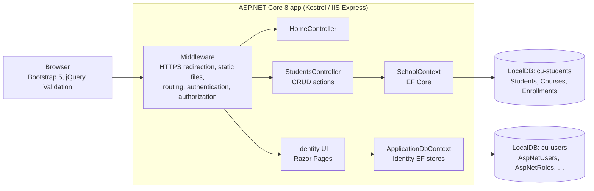
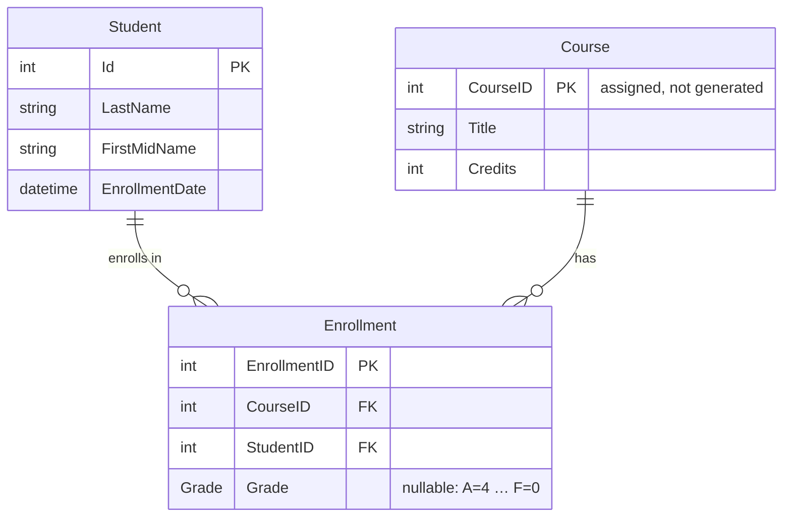

# Student Database: Full-Stack ASP.NET Core MVC

A full-stack web app for managing a university's student records. It has create, read, update and delete (CRUD) screens, user accounts, and a relational SQL Server database accessed through Entity Framework Core. It's built on **ASP.NET Core 8 MVC** following Microsoft's *Contoso University* tutorial, which is why the project is named `ContosoUniversity`. It was completed for **TINFO 200 (Programming II for IT, C#)** at the **University of Washington Tacoma**.

---

## Features

- **Student management.** A list of all students, plus details, create, edit and delete pages, with server-side and client-side validation.
- **User accounts.** Register, log in, log out and manage your account with ASP.NET Core Identity, which requires a confirmed account to sign in.
- **Automatic database setup.** On startup the app creates the school database if it's missing and seeds it with sample students, courses and enrollments.
- **Responsive UI.** Razor views styled with Bootstrap 5, with jQuery Validation for instant form feedback.
- **Query-string demo.** `/Home/Privacy?first=…&last=…&email=…` passes values to the view through `ViewData`. Razor HTML-encodes them on output.

---

## Architecture



- **MVC.** Controllers handle requests, Razor views render HTML, and EF Core entity classes are the models. Routing uses the conventional `{controller=Home}/{action=Index}/{id?}` pattern, plus `MapRazorPages()` for the Identity UI.
- **Two databases, two contexts.** Domain data (`SchoolContext` → `cu-students`) is kept separate from authentication data (`ApplicationDbContext` → `cu-users`). Each has its own connection string.
- **Dependency injection.** Both `DbContext`s are registered in `Program.cs` and constructor-injected into controllers.
- **Async data access.** Data access is asynchronous throughout (`ToListAsync`, `FirstOrDefaultAsync`, `FindAsync`, `SaveChangesAsync`).

---

## Data model



- `Grade` is a nullable enum (`A = 4, B = 3, C = 2, D = 1, F = 0`). A null grade means no grade has been assigned yet, which is different from an F.
- `CourseID` uses `[DatabaseGenerated(DatabaseGeneratedOption.None)]`, so courses keep meaningful catalog numbers such as `1050 Chemistry`.
- The seed data has 8 students, 7 courses and 12 enrollments.

---

## Edge cases & safeguards

| Concern | How it's handled |
| --- | --- |
| Missing or invalid IDs | Each action returns `404 NotFound` when `id` is null or no matching record exists |
| Overposting | `[Bind("Id,LastName,FirstMidName,EnrollmentDate")]` whitelists the bindable fields on Create and Edit |
| Cross-site request forgery | Every POST action has `[ValidateAntiForgeryToken]`, and Razor forms emit the token automatically |
| Invalid input | `ModelState.IsValid` gates every write; invalid forms are redisplayed with validation messages |
| Concurrent edits | `DbUpdateConcurrencyException` is caught. If the student was deleted meanwhile, the action returns 404; otherwise the exception is re-thrown |
| Double delete | `DeleteConfirmed` tolerates a student that's already gone, then redirects to the list |
| Re-seeding | `DbInitializer` exits early if any students exist, so restarts never duplicate data |
| Seeding failures | Database creation and seeding run inside `try/catch`, and errors are logged instead of crashing startup |
| Misconfiguration | A missing `DefaultConnection` or `SchoolConnection` fails fast with a clear `InvalidOperationException` |
| Environment-specific errors | Development uses the developer exception page and the migrations endpoint; production uses `/Home/Error` and HSTS |

---

## Run it

**Requirements:** the .NET 8 SDK and SQL Server Express LocalDB. LocalDB is installed with Visual Studio's *ASP.NET and web development* workload.

> **Folder layout note:** the Razor views were uploaded through GitHub's web uploader, which flattened part of the `Views/` tree. The complete views sit at the repository root (`Home/`, `Shared/`, `Students/`, `_ViewImports.cshtml`, `_ViewStart.cshtml`), while `Views/` holds only a partial copy. ASP.NET Core looks for views under `Views/`, so move those folders and files into `Views/` before running. Otherwise `/Students` fails with "view not found".

```bash
# 1. Restore and build
dotnet restore
dotnet build

# 2. Create the Identity schema in cu-users
dotnet tool install --global dotnet-ef        # once
dotnet ef database update --context ApplicationDbContext

# 3. Run. The school database is created and seeded automatically.
dotnet run --launch-profile https            # https://localhost:7276
```

You can also open `ContosoUniversity.sln` in Visual Studio and press **F5** (IIS Express profile).

New accounts have to be confirmed before they can sign in. No email sender is configured, so the default Identity UI shows a confirmation link right after registration.

---

## Project structure

```
├── Program.cs                   service registration, middleware pipeline, DB creation and seeding
├── Controllers/
│   ├── HomeController.cs        Index, Privacy (query-string demo), Error
│   └── StudentsController.cs    scaffolded async CRUD over SchoolContext
├── Data/
│   ├── SchoolContext.cs         Students, Courses, Enrollments
│   ├── ApplicationDbContext.cs  Identity tables
│   ├── DbInitializer.cs         idempotent seed data
│   └── Migrations/              Identity schema migration
├── Models/                      Student, Course, Enrollment (+ Grade enum), ErrorViewModel
├── Views/ (+ root-level copies) Razor views: Home, Shared/_Layout, Students CRUD
├── Areas/Identity/              Identity UI uses the shared layout
├── wwwroot/                     site CSS/JS, Bootstrap 5.1, jQuery 3.6, jQuery Validation
└── appsettings.json             connection strings for cu-users and cu-students
```

## Known limitations

- The navbar links to *About*, *Courses*, *Instructors* and *Departments* come from later tutorial chapters. Those controllers aren't implemented yet, so the links return 404.
- The school database is created with `EnsureCreated()`, which bypasses migrations, while Identity uses migrations. Moving the school schema to EF migrations would allow schema changes without dropping the database.
- Build output (`obj/`) is committed. A `.gitignore` for .NET would keep the repo lean.

## Tech

C# · ASP.NET Core 8 MVC · Razor · Entity Framework Core 8 (SQL Server provider) · ASP.NET Core Identity · SQL Server Express LocalDB · Bootstrap 5.1 · jQuery 3.6 · jQuery Validation (unobtrusive) · Visual Studio scaffolding
